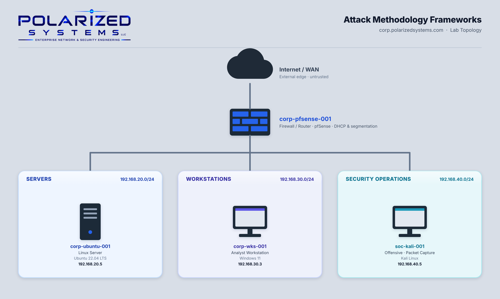

# Attack Methodology Frameworks

[← Back to Incident Response Management](../README.md)

---

## Overview

**Attack methodology frameworks** provide network security professionals with structured approaches to understanding how adversaries plan, execute, and carry out cyberattacks. These frameworks help organizations anticipate threats, identify attacker techniques, strengthen defensive controls, and improve incident response.

**Key Frameworks Explored:**

- **Lockheed Martin Cyber Kill Chain:** Examined the seven stages of a cyberattack and opportunities to detect and disrupt threats throughout the attack lifecycle.
- **MITRE ATT&CK:** Analyzed real-world adversary tactics and techniques using ATT&CK Navigator to investigate threat group behavior.
- **OWASP Web Security Testing Guide (WSTG):** Applied web security testing techniques to identify server technologies, research potential vulnerabilities, and validate findings.

### Learning Outcomes

This lab covers the following exercises:

- Exercise 1 – Attack Methodology Frameworks
- Exercise 2 – OWASP Testing Framework

After completing this lab, you should be able to:

- Map attacker activity to the Cyber Kill Chain and its defensive courses of action
- Research threat actors and their techniques with MITRE ATT&CK and the ATT&CK Navigator
- Deploy and secure an Apache web server with `systemd` and `ufw`
- Fingerprint a web server from its HTTP response headers with `wget` and `curl`
- Research vulnerabilities in CVE.org and NVD and interpret CVSS scores
- Validate findings against distribution backports to avoid reporting false positives

---

## Objectives

- Explain the seven phases of the Cyber Kill Chain and how defenders disrupt each one
- Use MITRE ATT&CK and the ATT&CK Navigator to research a threat group and visualize its techniques
- Apply the OWASP testing methodology to fingerprint a web server and research its vulnerabilities
- Validate scanner-style findings against vendor patch data to rule out false positives

---

## Lab Environment

| Hostname | IP Address | Operating System | Role |
|----------|-----------|------------------|------|
| `corp-pfsense-001` | — | pfSense | Firewall / router between subnets |
| `corp-ubuntu-001` | 192.168.20.5 | Ubuntu 22.04.5 LTS | Apache web server (test target) |
| `corp-wks-001` | 192.168.30.3 | Windows 11 | Framework research (Microsoft Edge) |
| `soc-kali-001` | 192.168.40.5 | Kali Linux | Web server fingerprinting and vulnerability research |

---

## Exercises

| # | Exercise | Frameworks / Tools |
|---|----------|--------------------|
| 1 | [Attack Methodology Frameworks](exercise-1-attack-methodology-frameworks/README.md) | Cyber Kill Chain · MITRE ATT&CK · ATT&CK Navigator |
| 2 | [OWASP Testing Framework](exercise-2-owasp-testing-framework/README.md) | OWASP WSTG · Apache · `wget` · `curl` · CVE.org · NVD |

