# Exercise 1 – Attack Methodology Frameworks

[← Back to Lab Overview](../README.md)

---

## Overview

Understanding how adversaries operate is essential to **proactive threat detection and incident response**. In this exercise, I explore two complementary attack methodology frameworks used to analyze cyberattacks and strengthen defensive strategies.

| Framework | Security Application |
|---|---|
| **Lockheed Martin Cyber Kill Chain** | Identifies the stages of an attack and opportunities to detect, disrupt, or prevent an intrusion. |
| **MITRE ATT&CK** | Maps real-world adversary tactics and techniques to support threat analysis, detection engineering, and incident investigation. |

Together, these frameworks help security teams understand **when attackers operate, how they execute attacks, and where defensive controls can be applied**.

## Devices

- **corp-wks-001** – Windows 11 – Microsoft Edge (192.168.30.3)

---

## Part 1 – Lockheed Martin Cyber Kill Chain®

1. Browse to Lockheed Martin's Cyber Kill Chain page:

   ```
   https://www.lockheedmartin.com/en-us/capabilities/cyber/cyber-kill-chain.html
   ```

   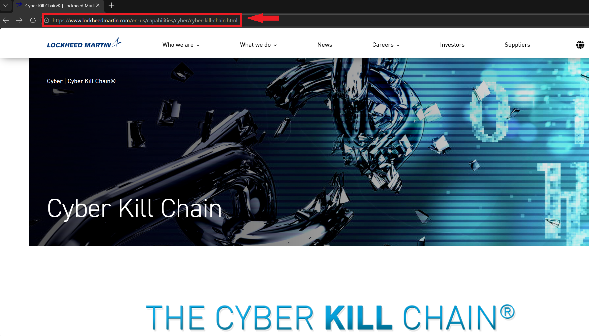

2. Review the overview. The Cyber Kill Chain is part of Lockheed Martin's **Intelligence Driven Defense®** model. It identifies what an adversary must complete to achieve their objective and frames the threat as an **APT**: *Advanced* and *Persistent* (targeted, coordinated, purposeful) with a *Threat* actor who has intent, opportunity and capability.

   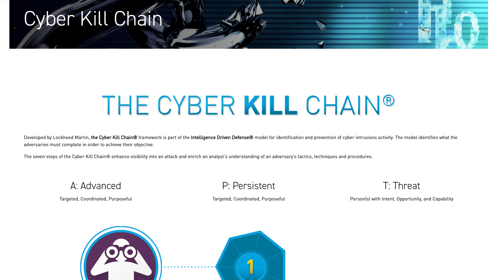

3. Review the seven phases:

   | # | Phase | What the adversary does |
   |---|-------|-------------------------|
   | 1 | **Reconnaissance** | Researches and selects targets: harvesting email addresses, conference details and other public information |
   | 2 | **Weaponization** | Couples an exploit with a backdoor into a deliverable payload |
   | 3 | **Delivery** | Sends the weapon to the victim by email, web or USB |
   | 4 | **Exploitation** | Exploits a vulnerability to execute code on the victim's system |
   | 5 | **Installation** | Installs malware to maintain persistence |
   | 6 | **Command & Control (C2)** | Opens a channel to control the victim remotely |
   | 7 | **Actions on Objectives** | With "hands on keyboard" access, accomplishes the original goal |

   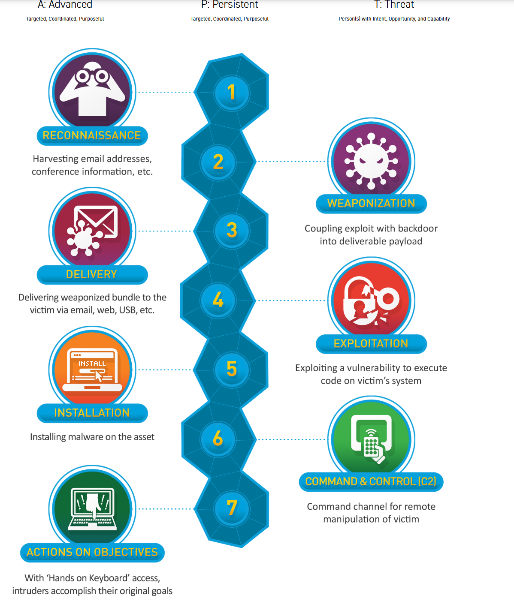

4. Open the original Lockheed Martin white paper that introduced the model, *Intelligence-Driven Computer Network Defense Informed by Analysis of Adversary Campaigns and Intrusion Kill Chains*:

   ```
   https://www.lockheedmartin.com/content/dam/lockheed-martin/rms/documents/cyber/LM-White-Paper-Intel-Driven-Defense.pdf
   ```

   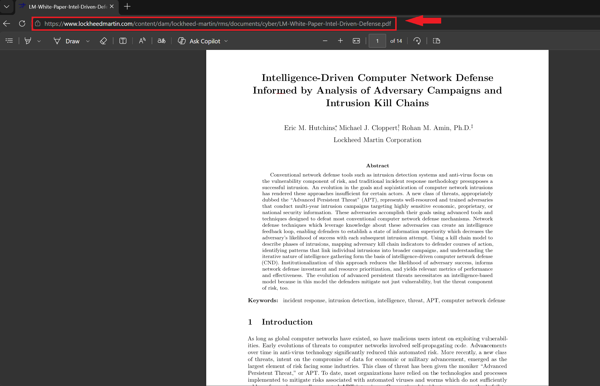

5. Review **Section 3.2, Intrusion Kill Chain**. The model adapts U.S. military targeting doctrine: it is called a *chain* because interrupting any one step interrupts the entire intrusion. The paper notes that email attachments, websites and USB media were the most common delivery vectors observed by Lockheed Martin's incident response team.

   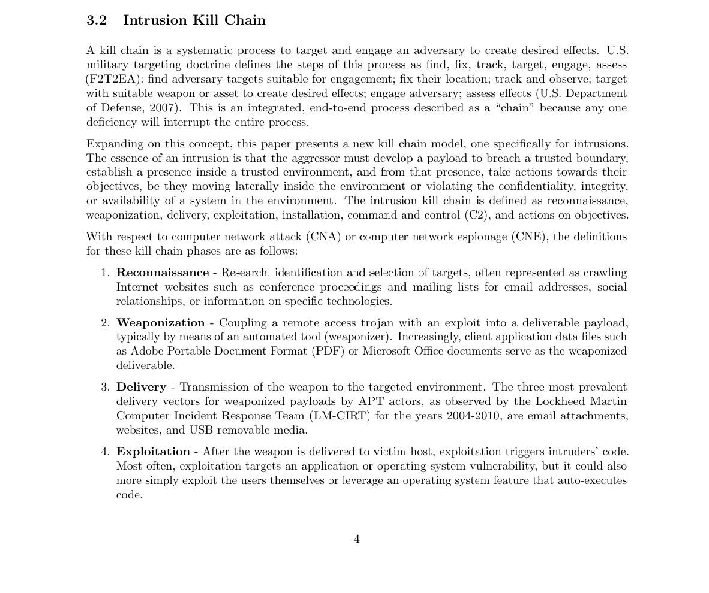

   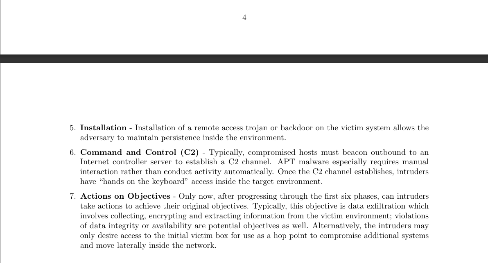

6. Review **Section 3.3, Courses of Action**. The **Courses of Action Matrix** maps each phase to six defensive actions (**Detect, Deny, Disrupt, Degrade, Deceive, Destroy**) and the controls that deliver them:

   | Phase | Example controls |
   |-------|------------------|
   | Reconnaissance | Web analytics (detect), firewall ACL (deny) |
   | Delivery | Vigilant users (detect), proxy filter (deny), inline AV (disrupt) |
   | Exploitation | HIDS (detect), **patching (deny)**, DEP (disrupt) |
   | Command & Control | NIDS (detect), firewall ACL (deny), DNS redirect (deceive) |
   | Actions on Objectives | Audit logs (detect), honeypot (deceive) |


   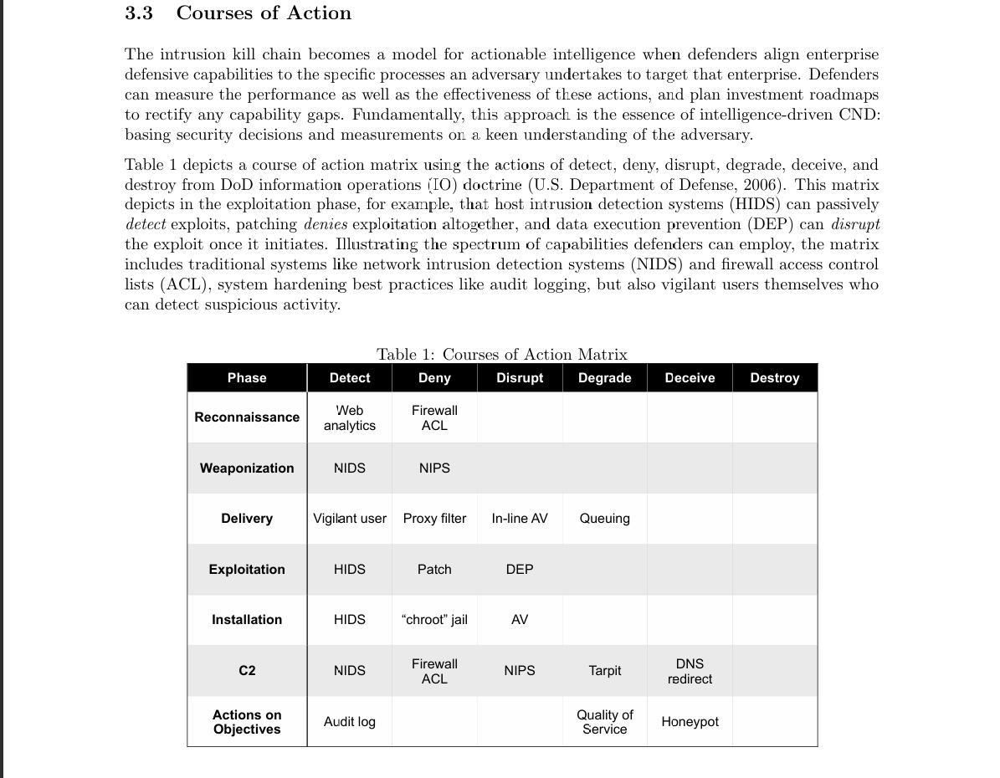

7. Open Lockheed Martin's analyst guide, *Gaining the Advantage: Applying Cyber Kill Chain® Methodology to Network Defense*:

   ```
   https://www.lockheedmartin.com/content/dam/lockheed-martin/rms/documents/cyber/Gaining_the_Advantage_Cyber_Kill_Chain.pdf
   ```

   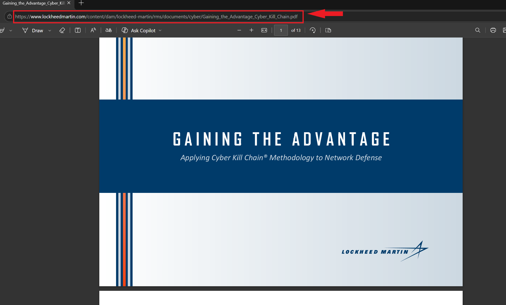

8. Review **The Modern Day Attacker**: adversaries are sophisticated, well-resourced and motivated, and their tools and techniques can defeat most common network defenses.

   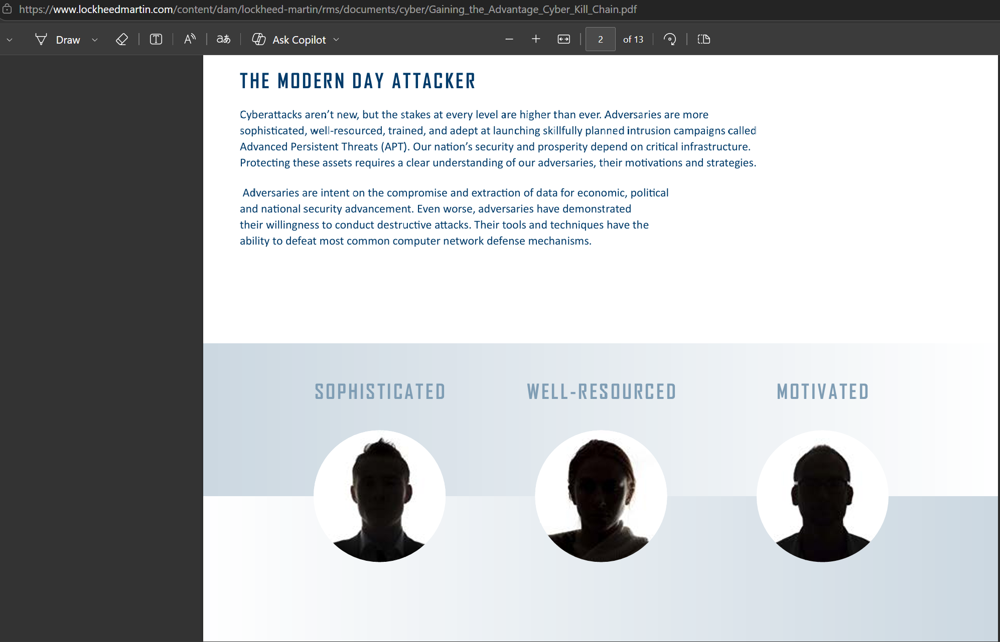

9. Review the model's core principle: an intruder succeeds **only if they complete all seven steps**. The defender only needs to block one.

   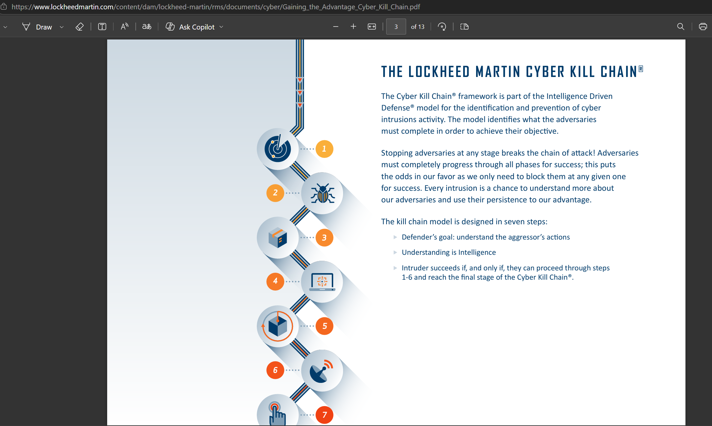

10. Review **Actions on Objectives**, which pairs the adversary's goals (credential theft, privilege escalation, lateral movement, data exfiltration, destruction) with the defender's response, including an *incident response playbook with executive engagement and a communications plan*, rapid forensic triage and damage assessment.

    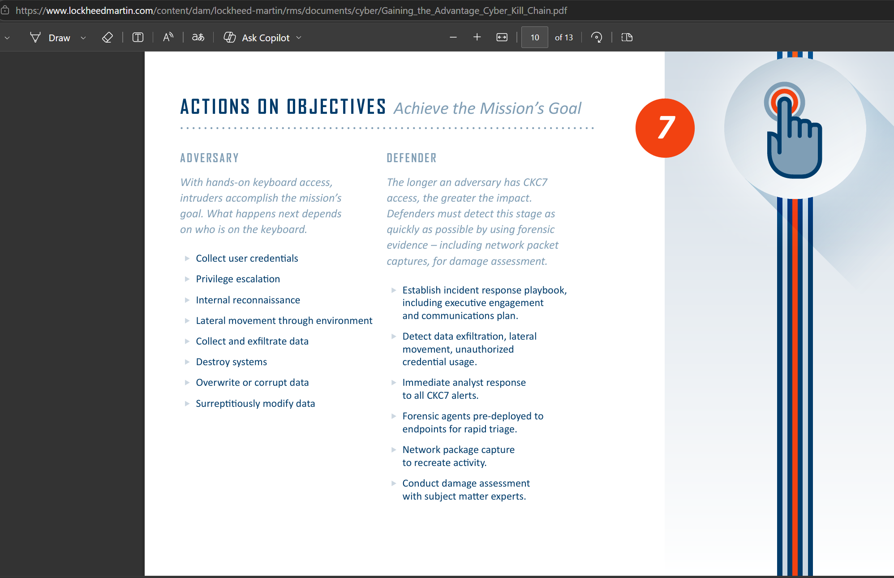

11. Review the **Conclusion**: the defender has seven opportunities to break the chain, and *"there is no such thing as secure, only defendable."*

    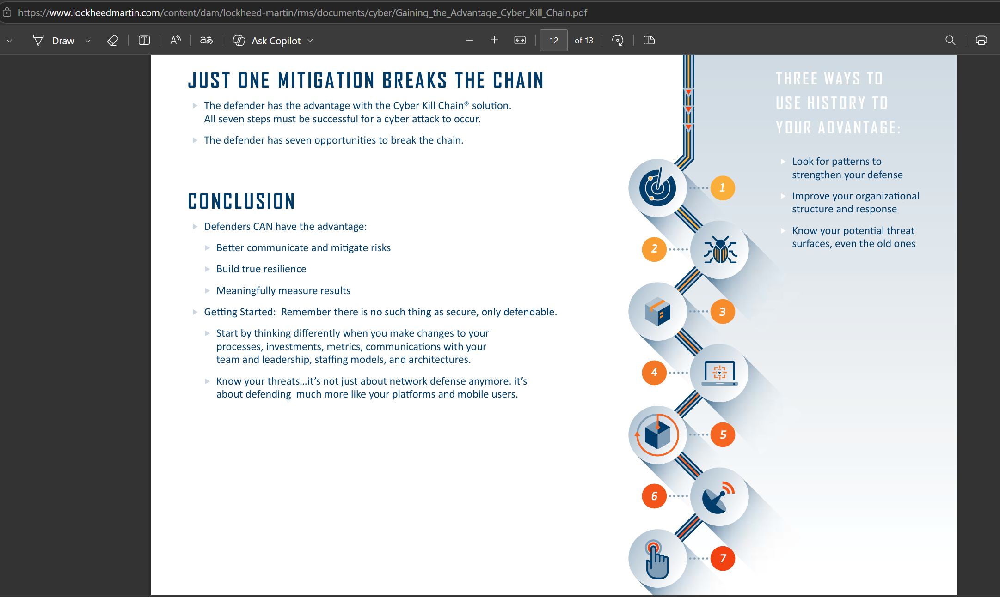

---

## Part 2 – MITRE ATT&CK®

1. Browse to MITRE ATT&CK:

   ```
   https://attack.mitre.org/
   ```

   ATT&CK is a globally accessible knowledge base of adversary tactics and techniques based on real-world observations. The **Enterprise Matrix** organizes techniques under 15 tactics, from Reconnaissance through Impact.

   > **Note:** The knowledge base was on **ATT&CK v20** at the time of this lab.

   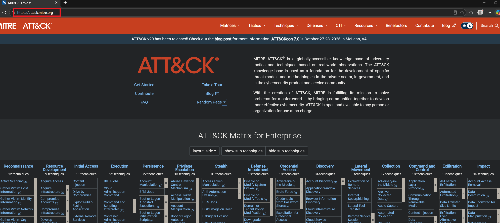

2. Hover over **CTI** and select **Groups**.

   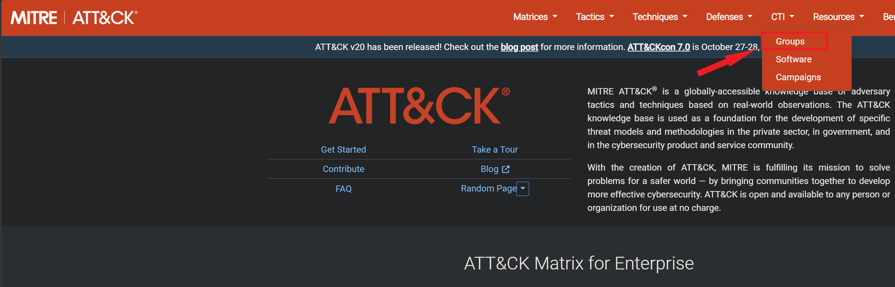

3. The Groups page lists the tracked threat groups (182 at the time of this lab), each with an ID, associated group names and a description. Select **Ajax Security Team**.

   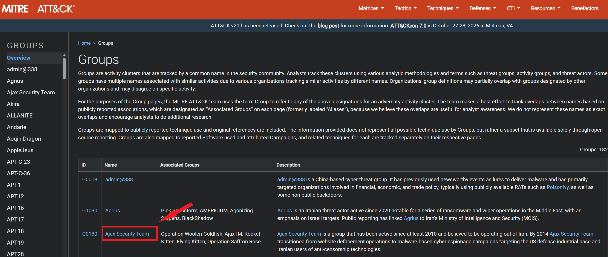

4. Review the group profile. **Ajax Security Team (G0130)** has been active since at least 2010 and is believed to operate out of Iran. By 2014, it had moved from website defacement to malware-based cyber espionage targeting the U.S. defense industrial base and Iranian users of anti-censorship technologies.


   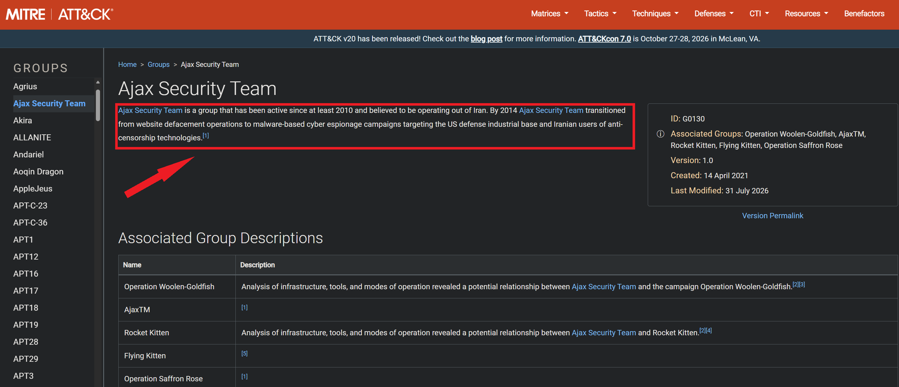

5. Hover over **Matrices** and select **Enterprise**. The Enterprise Matrix covers Windows, macOS, Linux, cloud, identity providers, network devices, containers and more.

   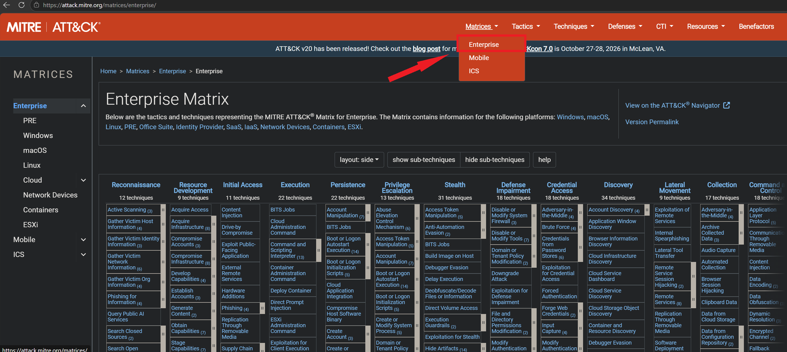

6. Select **View on the ATT&CK® Navigator**.

   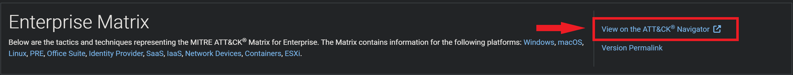

7. The **ATT&CK Navigator** is a web-based tool for annotating and exploring ATT&CK matrices, used to visualize defensive coverage, plan red and blue team activity and track detected techniques. Under **Create New Layer**, select **Enterprise ATT&CK**.

   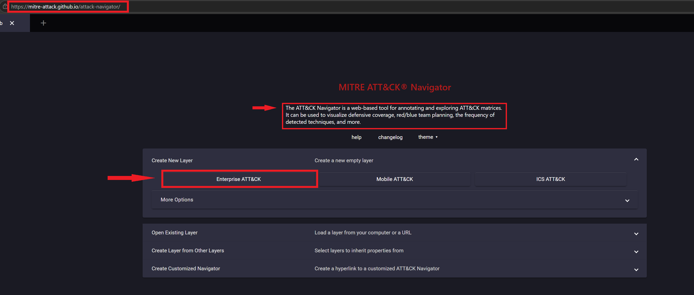

8. Open the **search** pane and expand **Threat Groups**.

   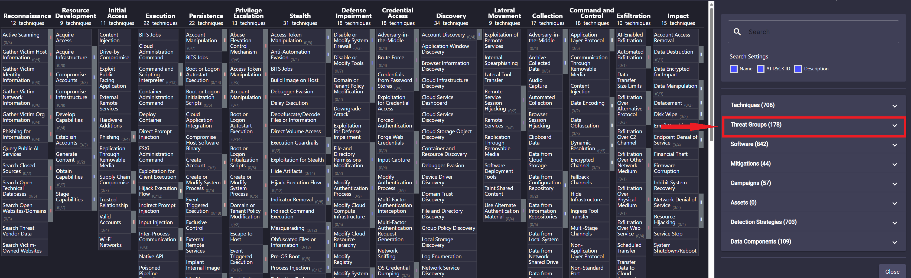

9. Find **APT19** and click **select**.

   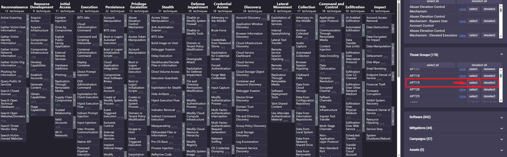

10. Close the search pane. The matrix now highlights every technique attributed to **APT19 (G0073)**, a China-based threat group, including **Drive-by Compromise**, **Command and Scripting Interpreter**, **Modify Registry** and **Deobfuscate/Decode Files or Information**.

    
    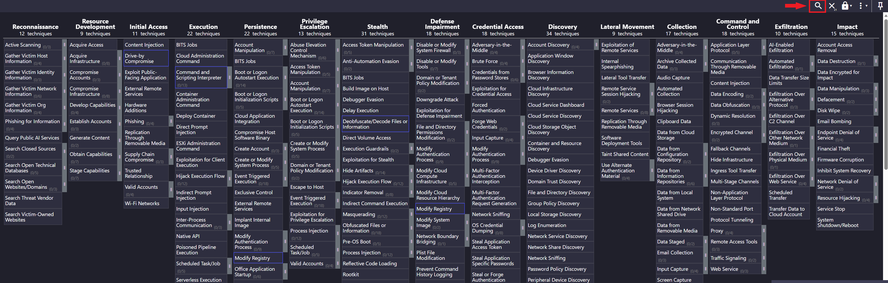

---

[← Back to Lab Overview](../README.md) | [Next: Exercise 2 – OWASP Testing Framework →](../exercise-2-owasp-testing-framework/README.md)
