# Exercise 2 – OWASP Testing Framework

[← Back to Lab Overview](../README.md)

---

## Overview

The **Open Worldwide Application Security Project (OWASP)** provides standardized security testing methodologies to help organizations identify vulnerabilities in web applications, mobile applications, and firmware.

In this exercise, I explored the **OWASP Web Security Testing Guide (WSTG)** to assess web server security, identify potential vulnerabilities, and evaluate security weaknesses using established testing practices.

## Key Learning Objectives
- **OWASP Frameworks:** Understand the purpose of web, mobile, and firmware security testing methodologies.
- **Web Server Assessment:** Identify potential vulnerabilities and insecure configurations.
- **Security Testing:** Apply OWASP testing guidelines to evaluate web server security.
>

  ## Devices
- **corp-ubuntu-001** – Ubuntu 22.04.5 LTS – Apache web server (192.168.20.5)
- **soc-kali-001** – Kali Linux – Analyst workstation (192.168.40.5)

---

## Task 1 – Deploy the Web Server

1. On **corp-ubuntu-001**, confirm the operating system release:

   ```bash
   lsb_release -a
   ```

   *Displays the Linux distribution, version and codename.* The server runs **Ubuntu 22.04.5 LTS (jammy)**.

   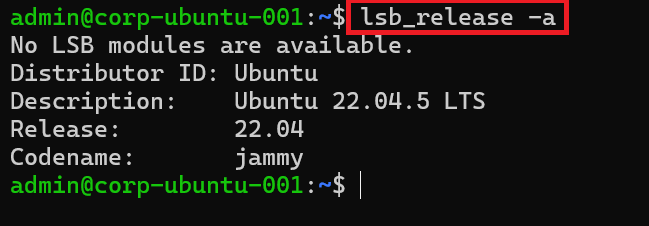

2. Refresh the package lists and install Apache:

   ```bash
   sudo apt update && sudo apt install -y apache2
   ```

   *`apt update` refreshes the package lists; `apt install -y apache2` installs the Apache web server without prompting.*

   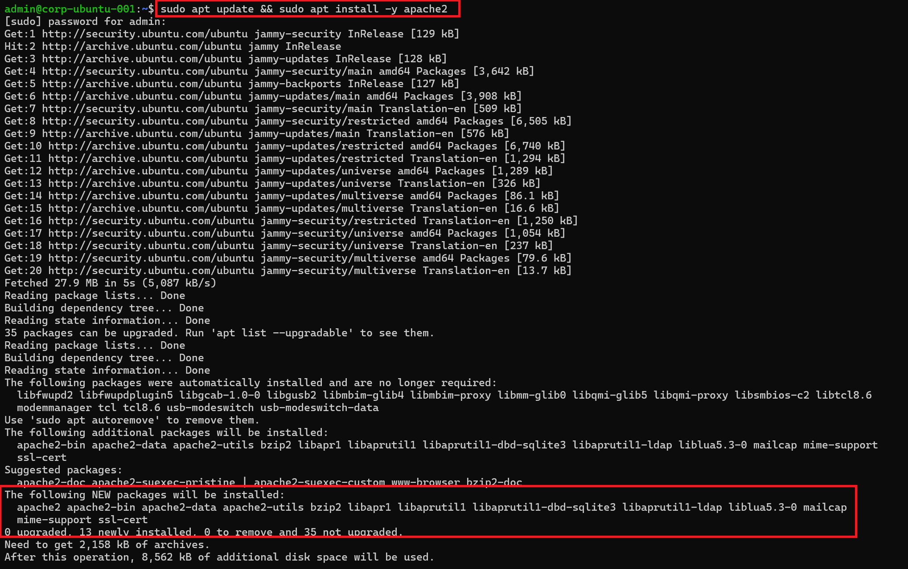

3. Start Apache, enable it at boot, confirm it's running and check its version:

   ```bash
   sudo systemctl enable --now apache2
   sudo systemctl status apache2 --no-pager
   apache2 -v
   ```

   *`enable --now` starts the service and sets it to start at every boot; `status` shows whether it's running; `apache2 -v` prints the installed version.* Apache is **active (running)**, version **Apache/2.4.52 (Ubuntu)**.

   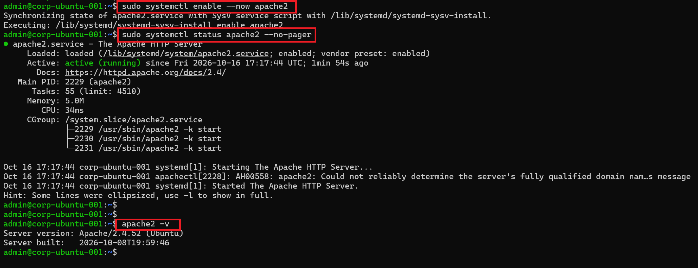

4. Enable the host firewall and allow web traffic:

   ```bash
   sudo ufw status
   sudo ufw enable
   sudo ufw allow 'Apache'
   sudo ufw status
   ```

   *`ufw` (Uncomplicated Firewall) manages the host firewall. The `Apache` profile opens TCP port 80.* The firewall was **inactive**, so I enabled it and confirmed that the only allowed service is **Apache**, for both IPv4 and IPv6.

   > **Security note:** Enabling `ufw` follows the principle of least privilege: only the port the web server needs is open to the network.

   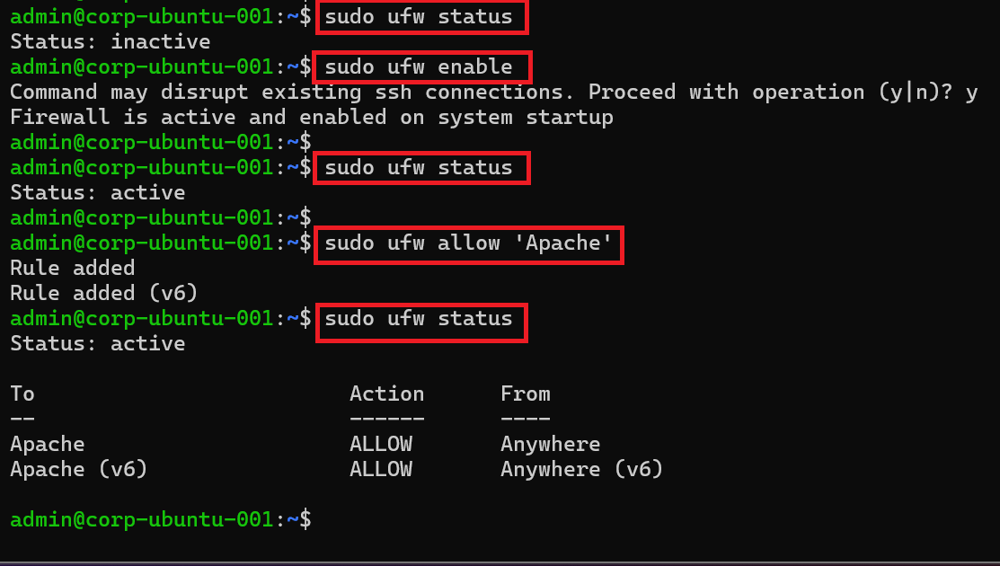

---

## Task 2 – Fingerprint the Web Server (WSTG-INFO-02)

1. From **soc-kali-001**, request the web page and display the server's response headers:

   ```bash
   wget 192.168.20.5 -q -S
   ```

   *Downloads the page; `-q` hides progress output and `-S` shows the server's HTTP response headers.*

   Then request the headers only:

   ```bash
   curl -s -I 192.168.20.5
   ```

   *`-s` runs silently and `-I` sends a HEAD request, returning only the headers.*

   Both responses include the header **`Server: Apache/2.4.52 (Ubuntu)`**, which reveals the web server software, its exact version and the operating system to anyone on the network.

   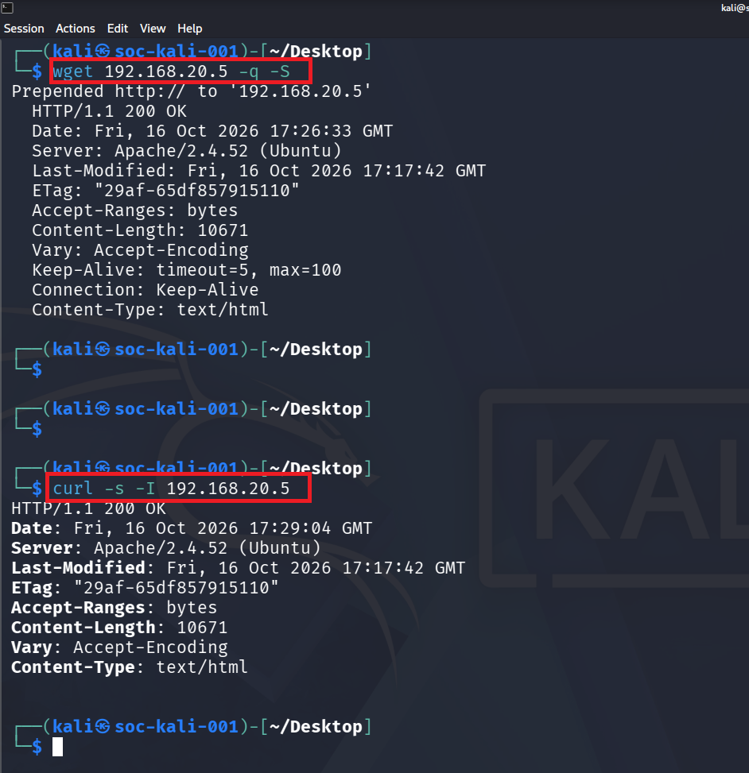

---

## Task 3 – Research the Version's Vulnerabilities

1. Open **Firefox** on soc-kali-001.

   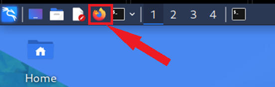

2. Browse to the CVE Program website:

   ```
   https://www.cve.org/
   ```

   > **Note:** The legacy `cve.mitre.org` search has been retired. CVE.org is the official home of the CVE Program.

   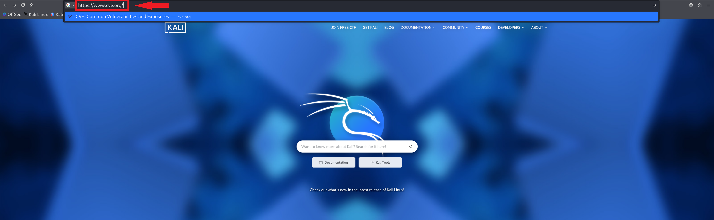

3. Search for the version identified in Task 2:

   ```
   Apache HTTP Server 2.4.52
   ```

   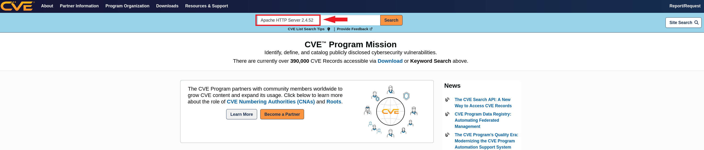

4. The search returns **four CVEs** that name Apache 2.4.52, including **CVE-2022-22720**: Apache HTTP Server 2.4.52 and earlier fails to close the inbound connection when errors occur while discarding the request body, exposing the server to **HTTP request smuggling**.

   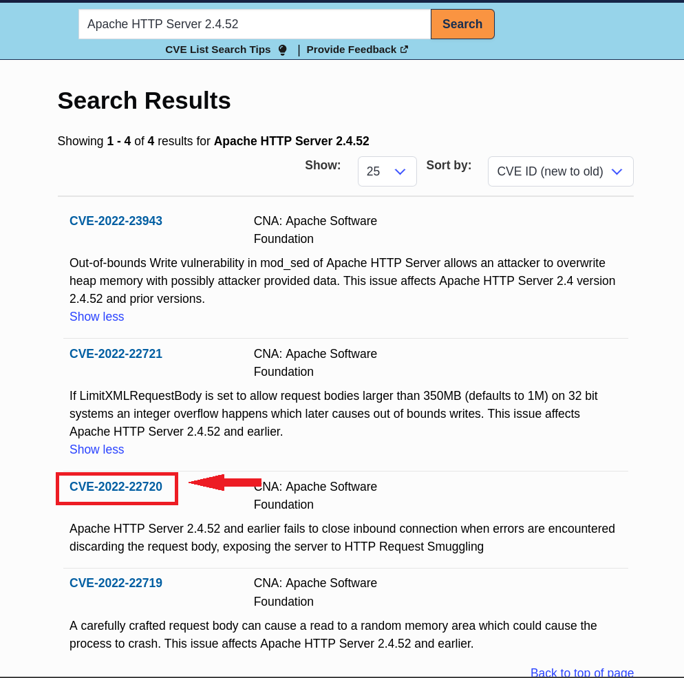

5. Open **CVE-2022-22720**. The record, published by the Apache Software Foundation, lists the weakness as **CWE-444: Inconsistent Interpretation of HTTP Requests** and the affected versions as **2.4 through 2.4.52**.

   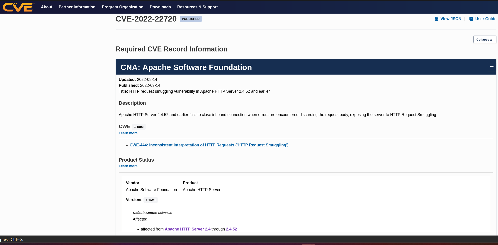

6. In **References**, select Apache's vendor advisory, `httpd.apache.org/security/vulnerabilities_24.html`.

   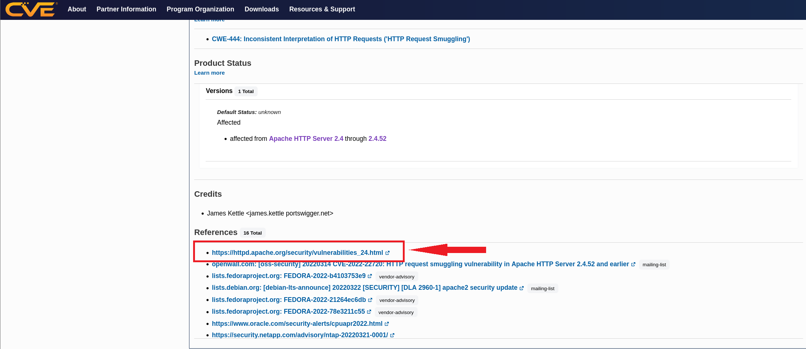

7. Apache's security page lists every vulnerability fixed in each 2.4 release. The current release is **Apache 2.4.69**, and this CVE was fixed upstream in 2.4.53.

   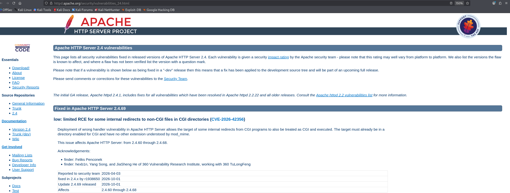

8. Search the **NIST National Vulnerability Database** for the same version:

   ```
   https://nvd.nist.gov/vuln/search
   ```

   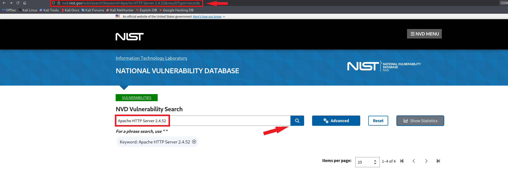

9. NVD returns the same four CVEs. The **CISA KEV** column shows none are in CISA's *Known Exploited Vulnerabilities* catalog, meaning there is no confirmed exploitation in the wild.

   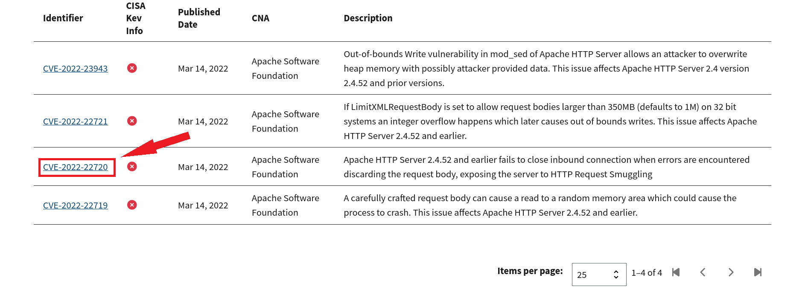

10. Open **CVE-2022-22720**. NVD rates it **CVSS 3.1: 9.8 CRITICAL** (`AV:N/AC:L/PR:N/UI:N/S:U/C:H/I:H/A:H`): exploitable over the network, with low complexity, no privileges and no user interaction.

    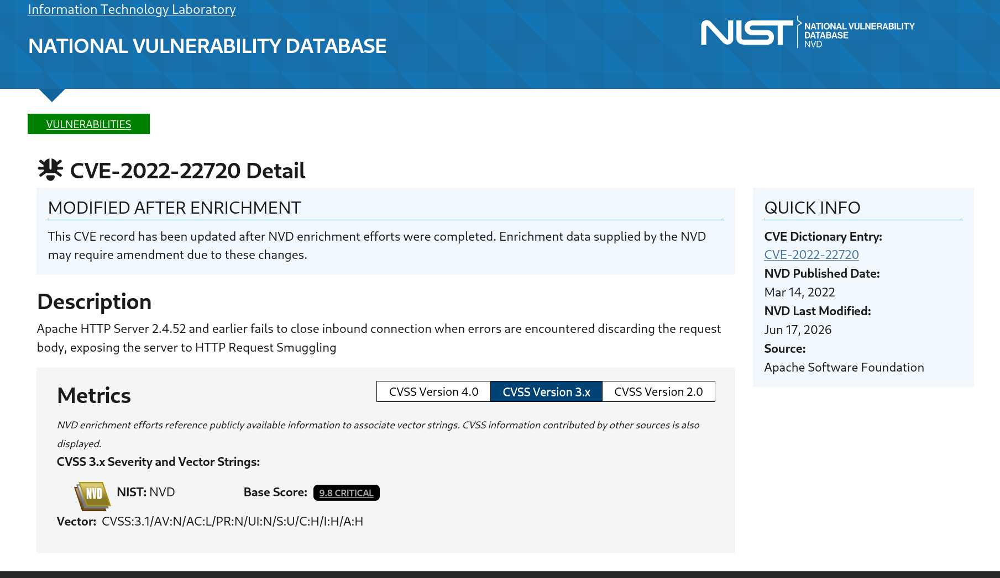

11. Review **References to Advisories, Solutions, and Tools**, which link to vendor and distribution security advisories.

    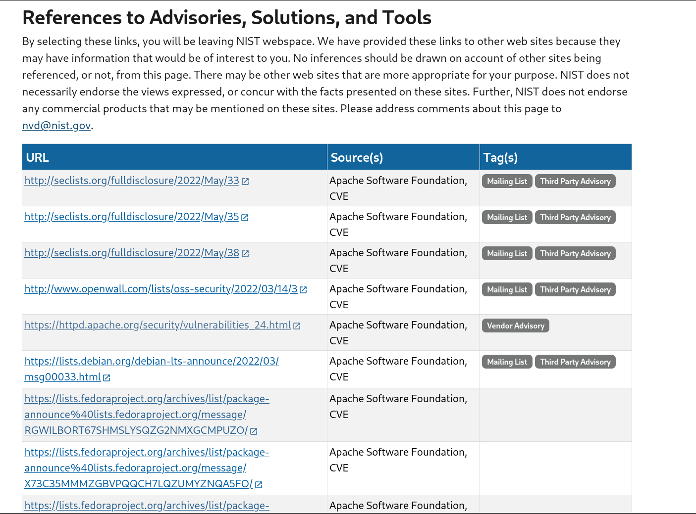

---

## Task 4 – Validate the Finding

A version string alone doesn't prove a server is vulnerable. Linux distributions such as Ubuntu **backport** security fixes into their packages without changing the upstream version number. Before reporting this as a critical finding, I checked the exact package installed.

1. On **corp-ubuntu-001**, display the installed Apache package version:

   ```bash
   apt policy apache2
   ```

   *Shows the installed package version, the newest available version and the repository each comes from.*

   The installed package is **`2.4.52-1ubuntu4.25`**, from the `jammy-security` repository, and is the newest available.

   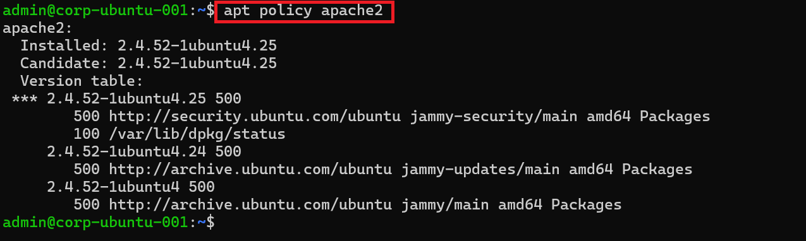

   **Result:** Ubuntu fixed CVE-2022-22720 in package **`2.4.52-1ubuntu2`**. The installed **`1ubuntu4.25`** is a later build that includes the fix, so the server is **not vulnerable**, even though its header still reports 2.4.52.

> ### Analyst Finding
>
> | | |
> |---|---|
> | **Observation** | Web server discloses `Server: Apache/2.4.52 (Ubuntu)` |
> | **Version-based match** | CVE-2022-22720, CVSS 9.8 Critical |
> | **Validation** | Installed package `2.4.52-1ubuntu4.25` includes Ubuntu's backported fix |
> | **Conclusion** | **False positive.** The CVE does not apply. |
> | **Residual risk** | **Information disclosure (low).** The header advertises the exact version, which helps attackers target the server. |
> | **Recommendation** | Set `ServerTokens Prod` and `ServerSignature Off` so Apache reports only `Server: Apache`, and keep the package updated through `jammy-security`. |

---

>
> "The server's header said Apache 2.4.52, which matches a critical, 9.8-rated vulnerability on paper. But Ubuntu backports security fixes without changing the version number, so I checked the installed package and it was already patched. Validating findings this way keeps the team focused on real risk instead of chasing false positives. The one real issue was that the server advertises its version, which is a simple configuration fix."

---

[← Previous: Exercise 1](../exercise-1-attack-methodology-frameworks/README.md) | [Back to Lab Overview](../README.md)
