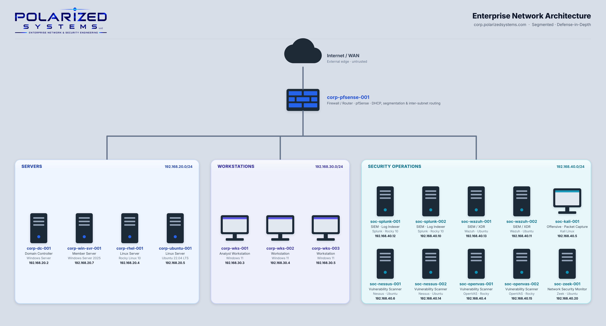

# Incident Response Management

## Overview

Incident Response (IR) is the structured process of identifying, investigating, containing, and recovering from cybersecurity incidents while minimizing operational disruption and business risk.

Effective incident response requires technical investigation, coordinated containment, system recovery, and clear communication with stakeholders and leadership. Lessons learned help strengthen security controls and prevent recurring incidents.

In this section, we'll explore the incident response lifecycle, including threat analysis, incident investigation, containment, recovery, and reporting.

### Learning Outcomes

This section covers the following modules:

- Attack Methodology Frameworks
- OWASP Testing Framework
- Governance
- Risk Management
- Compliance & Resilience
- Building Security In
- Security Program Operations
- The Incident Response Lifecycle
- Preparation & Post-Incident
- Communicating Vulnerability & Compliance Findings
- Communicating Incident Response

After completing these modules, you should be able to:

- Map adversary activity to the Cyber Kill Chain and MITRE ATT&CK, and validate findings to rule out false positives
- Structure a security program around recognized governance frameworks (NIST CSF/RMF, ISO 31000)
- Quantify and handle risk with SLE/ALE/ARO and a living risk register
- Conduct business impact analysis and set recovery objectives (RTO, RPO, MTD)
- Plan and test business continuity and disaster recovery
- Embed security into the development lifecycle and threat-model with STRIDE and PASTA
- Run the incident-response lifecycle — detection, containment, eradication, recovery and post-incident review
- Report vulnerability, compliance and incident findings to the right audience, with mean-time metrics (MTTD, MTTR)

---

## Projects

| # | Project | What I Did | Key Tools / Sources |
|---|---------|------------|---------------------|
| 01 | [Attack Methodology Frameworks](01-attack-methodology-frameworks/README.md) | Applied the Cyber Kill Chain and MITRE ATT&CK, profiled a threat group in ATT&CK Navigator, then fingerprinted a web server and proved a critical CVE was a false positive | MITRE ATT&CK · ATT&CK Navigator · OWASP WSTG · CVE.org · NVD |
| 02 | [Governance, Risk & Compliance](02-governance-risk-and-compliance/README.md) | Synthesized a full GRC curriculum into a structured three-pillar reference — governance frameworks and controls, quantitative and qualitative risk management, and compliance and resilience | NIST CSF / RMF · ISO 31000 · BIA (RTO/RPO/MTD) · risk register · BCDR · threat modeling |
| 03 | [Managing Cybersecurity Incident Response](03-managing-cybersecurity-incident-response/README.md) | Mapped the full incident-response management discipline across four modules — building security in, program operations, the active response lifecycle, and preparation & post-incident learning | Secure SDLC · STRIDE / PASTA · NIST SP 800-61 · indicators of compromise · root-cause analysis |
| 04 | [Communicating Cybersecurity Findings Effectively](04-communicating-cybersecurity-findings-effectively/README.md) | Covered the last mile of security work — turning vulnerability, compliance, and incident findings into clear, audience-appropriate reporting across every stakeholder from the SOC to the C-suite | Executive reporting · vulnerability & compliance reporting · the 5 W's · MTTD / MTTR metrics · stakeholder communication |

---

## Process Documentation

-  [**Incident Response Process** (SOP)](process/README.md) — the standard operating procedure this program follows: severity classification, the NIST SP 800-61 response lifecycle, and communication & reporting. ([branded PDF](process/Polarized-Systems-Incident-Response-Process.pdf))

---

## Related Portfolios

- [Security Operations](https://github.com/PolarizedSystems/Security-Operations)
- [Vulnerability Management](https://github.com/PolarizedSystems/Vulnerability-Management)
- [Windows Server Identity & Access Management](https://github.com/PolarizedSystems/Windows-Server-Identity-and-Access-Management)
