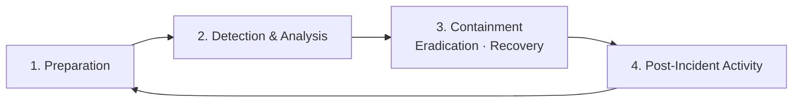

# Polarized Systems — Incident Response Process

**Owner:** Security Operations · **Version:** 1.0 · **Last reviewed:** October 2026
**Environment:** `corp.polarizedsystems.com` — segmented Server (192.168.20.0/24), Workstation (192.168.30.0/24) and Security Operations (192.168.40.0/24) subnets behind a pfSense firewall.
**Aligned to:** NIST SP 800-61 (Computer Security Incident Handling).

---

## 1. Purpose & Scope

This process defines how Polarized Systems prepares for, detects, contains and recovers from security incidents, and how it communicates them to the right people. It applies to any **confirmed or suspected compromise** of the confidentiality, integrity or availability of Polarized Systems systems or data — malware, unauthorized access, privilege escalation, data exfiltration, or denial of service.

---

## 2. Roles & Responsibilities

| Role | Responsibility |
|------|----------------|
| **Incident Response Lead** | Owns the incident end to end, declares severity, coordinates the response |
| **Security Analysts** | Detection, triage, analysis, containment and eradication actions |
| **Communications / Stakeholder Liaison** | Internal updates, and external/regulatory notification where required |
| **System owners** | Support containment and recovery of their systems |
| **Management** | Authorizes major actions (isolation, takedown), owns risk decisions |

---

## 3. Severity Classification

| Severity | Definition | Example | Response |
|----------|------------|---------|----------|
| **SEV-1 Critical** | Active, widespread, or business-critical impact | Domain-wide ransomware, active data exfiltration from a DC | Immediate, all-hands, management + external notification |
| **SEV-2 High** | Confirmed compromise, contained scope | Single server compromise, confirmed malware on a host | Urgent, same-day |
| **SEV-3 Medium** | Suspicious but unconfirmed, limited scope | Repeated failed-logon bursts, single phishing click | Standard triage |
| **SEV-4 Low** | Policy violation or low-impact event | Isolated policy breach, blocked malware | Routine handling |

---

## 4. The Lifecycle

**1. Preparation** — Maintain the controls that make response possible: centralized logging in **Splunk** (`soc-splunk-002`) and endpoint detection in **Wazuh** (`soc-wazuh-002`) across all endpoints, documented playbooks, current asset inventory, and known-good backups. Readiness is built before an incident, not during one.

**2. Detection & Analysis** — Identify and validate the incident from **Wazuh and Splunk alerts**, Windows Security event IDs (e.g. 4625 failed logons, 4728/4737 group changes), and user reports. Triage to confirm a **true positive**, establish scope (which hosts, accounts and data), and map observed activity to **MITRE ATT&CK** techniques to anticipate the attacker's next move. Assign a severity (Section 3) and open an incident record with a timeline.

**3. Containment, Eradication & Recovery**
- **Contain** — Limit the damage first: isolate affected hosts via **pfSense** segmentation/blocking, disable compromised accounts, and preserve evidence (memory, logs, disk images) before changing anything.
- **Eradicate** — Remove the root cause: malware, unauthorized accounts, persistence mechanisms, and the vulnerability that allowed entry.
- **Recover** — Restore systems from known-good backups, confirm they are clean, and return to production with **heightened monitoring** in Wazuh/Splunk to catch re-infection.

**4. Post-Incident Activity** — Within one week of closure, hold a lessons-learned review: what happened, how it was handled, what detection or control gaps it exposed, and what changes prevent a repeat. Feed findings back into Preparation (new detections, playbook updates, vulnerability remediation).

---

## 5. Communication & Reporting

| Audience | What | When |
|----------|------|------|
| **Internal — IR team & management** | Status updates, severity, actions taken | Continuously through the incident |
| **Internal — affected system owners** | Impact and required actions | At containment |
| **External — regulators / CISA / law enforcement** | Required notifications where legal or contractual obligations apply | Per applicable timelines (e.g. CISA, breach-notification law) |
| **Leadership — post-incident** | Business impact, cost, and remediation plan in business terms | After closure |

External and regulatory reporting is distinct from internal incident reports and is handled by the Communications/Stakeholder Liaison with management approval. Technical findings are translated into **business impact** for leadership — not raw indicators.

---

## 6. Tooling

- **Wazuh** (`soc-wazuh-002`) — endpoint detection, file-integrity and behavior monitoring across Windows and Linux
- **Splunk** (`soc-splunk-002`) — centralized log collection, correlation and investigation
- **pfSense** (`corp-pfsense-001`) — network containment and isolation
- **MITRE ATT&CK** — technique mapping and attacker-behavior analysis
- **Active Directory** — account disablement and privilege review during containment

---

## 7. References

- NIST SP 800-61 — Computer Security Incident Handling Guide
- MITRE ATT&CK Framework · CISA Incident Reporting guidance
